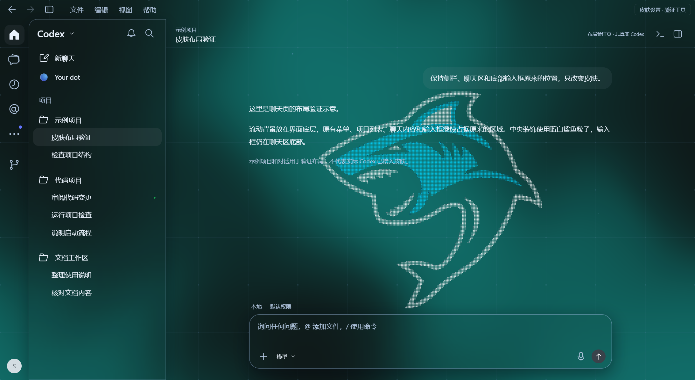

# Codex Liquid Glass · 液态玻璃皮肤

[](https://github.com/SuperSgdk/codex-liquid-glass/actions/workflows/check.yml)
[](LICENSE)

流动背景、毛玻璃材质、连续调色和蓝白鲨鱼粒子，为 Codex 桌面界面提供可调的视觉皮肤。由 SuperSgdk 独立维护，基于 [DSH Liquid Glass](https://github.com/SuperSgdk/DSH-Liquid-Glass-Theme) 的材质、配色和环境装饰适配。



*减少动画模式下的本地验证页效果，页面中的项目和文字均为示例。真实 Codex 桌面接入仍待验收。*

## 效果与调节

- **流体背景**：WebGL2 渲染，连续调节色调、颜色深浅和背景亮度；无 WebGL2 时提供静态颜色背景。
- **玻璃材质**：侧栏与输入区分别呈现背景透色，可调模糊度、磨砂度及鼠标光影。
- **鲨鱼粒子**：5,745 个蓝白点聚合成形，轻微漂移，鼠标拨散后回弹；保持原图颜色。
- **环境交互**：气泡、浮游、网格与鼠标辉光可分别开关。
- **布局适配**：皮肤在独立底层绘制，保留 Codex 原有侧栏、输入框、菜单和聊天操作。

支持跟随界面、浅色和深色。默认参数：模糊度 `20px`、磨砂度 `7%`、色调 `320°`、颜色深浅 `25%`、背景亮度 `50%`。色调经过连续配色算法处理；设置保存在独立的 `codex.glass.skin.v1` 键中。

## 运行预览

需要 Node.js 22 或更新版本；CI 使用 Node.js 24 和 pnpm 11.19.0。

```powershell
pnpm install --frozen-lockfile
pnpm run build
pnpm run preview
```

打开终端显示的 `http://127.0.0.1:4785/`。依赖安装并构建后，也可以双击 `启动预览.cmd`。顶部“皮肤设置 · 验证工具”用于调节效果。

## 加载到 Codex 桌面

原生颜色主题无法加载流体脚本。桌面加载器通过临时的本机回环调试连接，将本仓库构建的 `dist/codex-glass.runtime.js` 加载到主界面。当前已验证加载协议和浏览器页面，尚未完成真实桌面连接、视觉与聊天功能验收，操作及回退步骤见 [桌面加载文档](docs/native-loader.md)。

只检查已存在的调试连接：

```powershell
pnpm run skin:inspect
```

选择接入时，保存内容、结束正在进行的任务并正常完全退出 Codex，然后在独立 PowerShell 窗口运行：

```powershell
powershell -NoProfile -File .\scripts\start-codex-skin.ps1
```

也可以双击 `启动Codex皮肤.cmd`。脚本发现 Codex 仍在运行时会停止并提示。启动后使用 `Ctrl+Alt+Shift+G` 开关设置，面板内 `Esc` 关闭并恢复原焦点。

已自行打开调试端口时，可单独加载或移除：

```powershell
pnpm run skin:apply
pnpm run skin:remove
```

`127.0.0.1:9223` 调试端口允许本机程序检查和控制应用，只在这次临时运行中使用。移除皮肤后正常退出 Codex，再按平时方式打开即可结束调试运行。刷新窗口或应用更新后可能需要重新加载、重新适配。

## 检查

```powershell
pnpm run check
```

包含严格 TypeScript 检查、构建和自动测试，覆盖参数边界、配色、渲染生命周期、设置焦点、粒子资源释放、调试目标筛选、WebSocket 协议与超时处理。GitHub Actions 在 Windows 与 Ubuntu 运行同一检查；它们不启动真实 Codex。当前浏览器验证与发布检查记录见 [验证记录](docs/publication-validation-20261002.json)。

构建还生成六份原生颜色主题文本，供“设置 → 外观”导入，格式说明见 [兼容记录](docs/compatibility.md)。这些文本仅提供颜色和字体设置。首次公开源码；安装包和 Release 后续单独发布。

## 目录与许可

| 目录 | 内容 |
| --- | --- |
| `src/core/` | 流体渲染、配色、交互和资源生命周期 |
| `src/decorations/` | 鲨鱼粒子、气泡和浮游 |
| `src/skin/` | DOM 适配、玻璃材质和设置面板 |
| `web/` | 使用同一皮肤运行包的本地验证页面 |
| `scripts/`、`tests/` | 构建、检查、预览和桌面加载器 |
| `dist/` | 构建生成的运行包及主题文本，不提交 |

项目代码使用 [AGPL-3.0-only](LICENSE)。作者、来源提交和许可边界见 [NOTICE](NOTICE)、[核心来源](src/core/PROVENANCE.txt)及 [装饰来源](src/decorations/PROVENANCE.md)。鲨鱼为 SuperSgdk 确认的自有图片，已授权本项目粒子化展示和公开；代码与素材的许可分别记录。构建与运行不依赖 DSH 安装路径。
