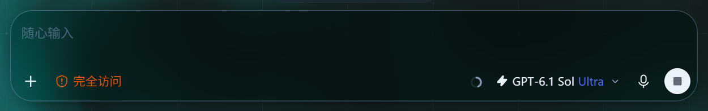

# Codex Liquid Glass · 液态玻璃皮肤

[](https://github.com/SuperSgdk/codex-liquid-glass/actions/workflows/check.yml)
[](LICENSE)

流动背景、毛玻璃材质、连续调色和蓝白鲨鱼粒子，为 Codex 桌面界面提供可调的视觉皮肤。由 SuperSgdk 独立维护，基于 [DSH Liquid Glass](https://github.com/SuperSgdk/DSH-Liquid-Glass-Theme) 的材质、配色和环境装饰适配。


*减少动画模式下的本地布局示例。项目和对话均为示例。最新输入框与左栏统一使用 26px 圆角。*

下面是 2026-10-03 从真实 Windows Codex 窗口截取的输入区：附件和权限在左侧，模型、语音和发送/停止按钮在右侧。皮肤保留原生结构和尺寸，启用时与左栏统一使用 26px 圆角，关闭后恢复原生圆角。



本地验证页还提供[设置页示例](docs/assets/preview-settings-dark.png)，用于检查切页后的背景和玻璃卡片。

## 效果与调节

- **流体背景**：WebGL2 渲染，按 DSH 的波纹尺度、慢速节奏和混色顺序呈现连续扭曲；可调色调、颜色深浅和背景亮度，无 WebGL2 时提供静态颜色背景。
- **玻璃材质**：侧栏与输入区均采用 26px 圆角，支持鼠标所在边向屏幕内轻微压倾、移开后回弹；使用 DSH 的透视和角度，并可调模糊度、磨砂度及鼠标光影。
- **随时开关**：Codex 设置页顶部提供“启用液态玻璃皮肤”和“调整皮肤”。关闭后恢复原生界面、释放动画及 GPU 资源，保留设置入口和参数；下次加载沿用上一次的开关状态。
- **鲨鱼粒子**：5,745 个蓝白点组成柔和的整齐点阵，整体轻微漂动；鼠标局部拨散后回到原位，保持原图颜色。初次显示和切换到另一聊天时播放约 0.9 秒的爆散和聚合；复用画布与固定点位缓冲，GPU 提前编译及上传点位，动画绘制上限为每秒 60 帧，结束后显示缓存。页面短暂移除聊天区域时保留尚未完成的开场，区域恢复后重新播放该开场；已完成的开场不会因同一聊天的区域恢复而重播。图形最大容器为 504px，约为原先 420px 的 1.2 倍，窄聊天列会适配可用范围。减少动画模式跳过聚合；GPU 不可用时使用限时降级动画。
- **环境交互**：气泡、浮游、网格与鼠标辉光可分别开关。
- **布局适配**：皮肤在独立底层绘制，保留 Codex 原有侧栏、输入框、菜单和聊天操作。

界面观察器缓存已找到的原生节点，无关正文的样式变化不再查询整段消息；前台多个变更批次合并到一帧，减少切换聊天时重复扫描。

支持跟随界面、浅色和深色。默认参数：模糊度 `20px`、磨砂度 `7%`、色调 `320°`、颜色深浅 `25%`、背景亮度 `50%`。色调经过连续配色算法处理；设置保存在独立的 `codex.glass.skin.v1` 键中。

## 运行预览

需要 Node.js 22 或更新版本；CI 使用 Node.js 24 和 pnpm 11.19.0。

```powershell
pnpm install --frozen-lockfile
pnpm run build
pnpm run preview
```

打开终端显示的 `http://127.0.0.1:4785/`。依赖安装并构建后，也可以双击 `启动预览.cmd`。顶部“皮肤设置 · 验证工具”用于调节效果。

## 加载到 Codex 桌面

原生颜色主题无法加载流体脚本。桌面加载器通过临时的本机回环调试连接，将本仓库构建的 `dist/codex-glass.runtime.js` 加载到主界面。2026-10-03 已在 Windows 安装包 `26.930.2377.0` 上验证真实连接、挂载、输入区材质及布局；主窗口筛选会排除同样使用 `index.html` 的头像浮窗。实际检查范围见[启动与动画验证记录](docs/startup-animation-validation-20261003.json)，操作及回退步骤见 [桌面加载文档](docs/native-loader.md)。

加载器在主窗口的 `head` 和 `body` 存在时就安装样式、背景与界面观察器，后续出现的聊天和输入区会自动适配；最后仍要匹配真正的 Codex 主界面才报告挂载成功。这样去掉了等待完整页面后才安装皮肤的额外延迟。启动进程、建立调试连接和系统负载仍影响首次显示时间，当前实现不保证零闪屏或所有聊天导航都没有卡顿。本次验证没有关闭并重新启动正在使用的 Codex。

只检查已存在的调试连接：

```powershell
pnpm run skin:inspect
```

首次接入时，若 Codex 尚未启用本机调试连接，先保存内容、结束正在进行的任务并正常完全退出 Codex，然后运行：

```powershell
powershell -NoProfile -File .\scripts\start-codex-skin.ps1
```

也可以双击 `启动Codex皮肤.cmd`。已有可用调试连接时只复用当前 Codex；已加载的控制器（包括皮肤关闭状态）不会再被替换或开启。普通启动的实例没有连接时会提示下次正常退出后再接入。`Ctrl+Alt+Shift+G` 打开设置面板，面板内 `Esc` 关闭并恢复原焦点。

一次安装独立桌面入口后，日常无需进入项目目录。下面先查看计划，再创建“Codex 液态玻璃”图标：

```powershell
powershell -NoProfile -File .\scripts\install-codex-entry.ps1 -WhatIf
powershell -NoProfile -File .\scripts\install-codex-entry.ps1
```

它打开同一个原生 Codex 和原来的配置，自动加载皮肤控制器，伴随 PowerShell 隐藏运行；已有连接就复用。该入口独立于商店和任务栏原有图标，不修改安装包。**从商店原有入口普通启动时，动态皮肤开关仍不会自动出现**；当前原生配色主题没有前端脚本加载入口。可用 `-Action Uninstall -WhatIf` 先查看卸载计划，再移除经过来源核验的独立图标。启动等待与失败提示有隔离测试；本次完整退出再打开的冷启动耗时未实测。

已自行打开调试端口时，可单独加载或移除：

```powershell
pnpm run skin:apply
pnpm run skin:remove
```

`127.0.0.1:9223` 调试端口允许本机程序检查和控制应用，仅在通过皮肤入口启动的本次进程中使用。设置中关闭皮肤释放视觉资源，保留控制器和调试连接以便重新开启。完全移除后正常退出 Codex，再按商店原有入口打开即可结束调试运行。刷新窗口或应用更新后可能需要重新加载、重新适配。

## 检查

```powershell
pnpm run check
```

包含严格 TypeScript 检查、构建和自动测试，覆盖参数边界、配色、渲染生命周期、设置焦点、开关恢复、桌面入口、点阵间距、开场聚合、聊天切换识别、GPU 预热与绘制限速、后台加载、粒子资源释放、调试目标筛选、WebSocket 协议与超时处理。GitHub Actions 在 Windows 与 Ubuntu 运行同一检查；它们不启动真实 Codex。测试项数以当次检查输出为准；本次范围见[启动与动画验证记录](docs/startup-animation-validation-20261003.json)。[圆角、总开关和桌面入口记录](docs/settings-toggle-validation-20261003.json)、[此前的流体与粒子实测](docs/native-validation-20261003.json)及[首次公开检查](docs/publication-validation-20261002.json)都是各自时点的历史快照，其中的测试数量和待确认状态不代表本次检查结果。

构建还生成六份原生颜色主题文本，供“设置 → 外观”导入，格式说明见 [兼容记录](docs/compatibility.md)。这些文本仅提供颜色和字体设置。当前版本保持 `0.2.0-dev`；本次发布源码更新，不创建版本标签或安装包 Release。

## 目录与许可

| 目录 | 内容 |
| --- | --- |
| `src/core/` | 流体渲染、配色、交互和资源生命周期 |
| `src/decorations/` | 鲨鱼粒子、气泡和浮游 |
| `src/skin/` | DOM 适配、玻璃材质和设置面板 |
| `web/` | 使用同一皮肤运行包的本地验证页面 |
| `scripts/`、`tests/` | 构建、检查、预览和桌面加载器 |
| `dist/` | 构建生成的运行包及主题文本，不提交 |

项目代码使用 [AGPL-3.0-only](LICENSE)。作者、来源提交和许可边界见 [NOTICE](NOTICE)、[核心来源](src/core/PROVENANCE.txt)及 [装饰来源](src/decorations/PROVENANCE.md)。鲨鱼为 SuperSgdk 确认的自有图片，已授权本项目粒子化展示和公开；代码与素材的许可分别记录。构建与运行不依赖 DSH 安装路径。
